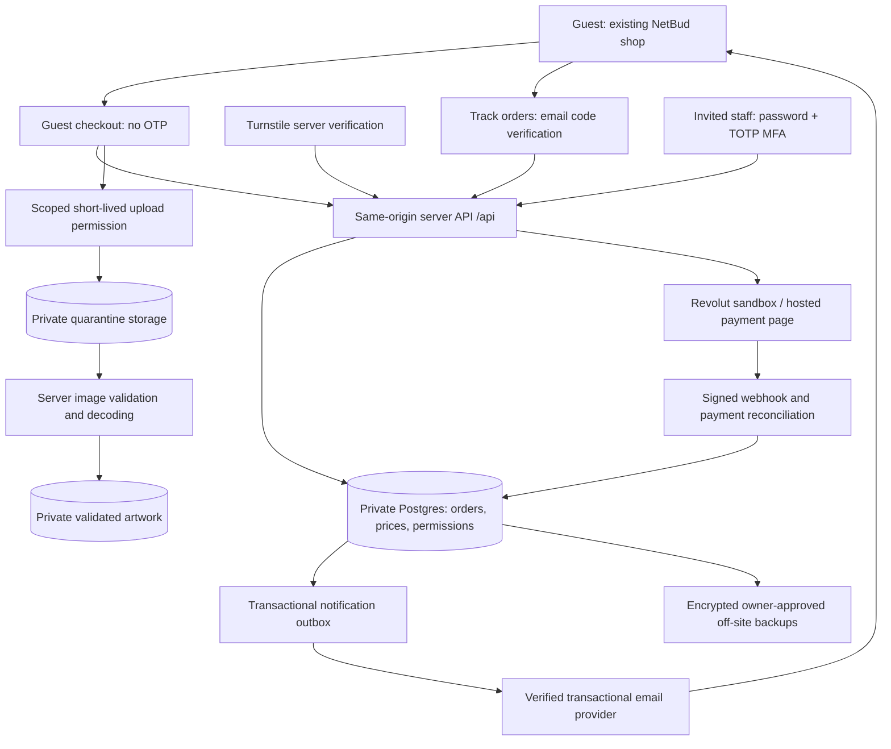

# Proposed architecture and security model

Design specification only; no deployed API, SQL policies, customer sessions or staff accounts exist yet. All controls below must be implemented and tested before being described as working.

## Data flow

GitHub holds code/migrations and synthetic fixtures only. Supabase stores private operational data; Cloudflare serves existing public assets and the API. A scheduled worker claims database outbox jobs with leases; it is not a second queue/database. Image validation may use an authenticated Supabase Edge Function if its benchmark passes. Unapproved integrations remain disabled. Payment cards are entered only on the approved provider-hosted page, never sent to NetBud.

## Small public experience

1. Reuse the existing shop and basket. Add product options only where relevant. Server returns versioned product configuration, availability and definitive totals.
2. One guest checkout collects full name, email, phone; business/notes optional. Australian address required only when shipping physical items. Validate state/postcode format and required address parts locally/server-side without claiming paid address verification.
3. Up to five differently personalized designs; two JPG/PNG images per design, max 10 MB each. Allow artwork later. Quantities and design assignments must reconcile per item.
4. Standard shipping A$14.95; free at physical subtotal >= A$99, excluding digital/services. Pickup A$0 by arrangement at the supplied Parramatta address; no invented hours. Server determines thresholds, option costs, discounts and tax.
5. Persist order/items and outbox atomically before acknowledging creation. Show order received/unpaid, not paid or email delivered. If DB commit fails, show retry with the same idempotency key; do not fabricate an order number.
6. Track My Order uses email OTP only when retrieving orders. Verified session lists all orders for that exact normalized email. No password/customer registration. Checkout confirmation never grants unrestricted history access.
7. Physical items and quoted services can coexist. Only approved payable items appear in a payment request; quoted website work remains Awaiting Quote. No silent deductions or recurring billing.

All routes use NetBud fonts, colours and components. Do not load checkout animation into the public hero controller. Portal/admin pages contain no invented sales or customer records.

## Database model

All timestamps are UTC `timestamptz`, displayed in Australia/Sydney. Monetary values use integer AUD cents, checked non-negative ranges and immutable pricing/tax snapshots. UUIDs are identifiers, not authorization secrets. Foreign keys, uniqueness and transaction locks enforce invariants.

| Tables | Relationships / important constraints |
| --- | --- |
| `products`, `product_versions`, `product_options` | Stable existing catalogue ID; physical/digital/service and fixed/quote/hybrid; GST class, quantity/discount rules, finishes, stock/made-to-order, included revisions, lead time, deposits and recurring terms. Active version immutable once ordered. No unapproved options sold. |
| `customers`, `customer_contacts` | Minimal identity keyed by normalized email; optional business, name/phone. No password or customer Auth account. Versioned delivery/billing snapshots only where needed for order/tax evidence. |
| `orders`, `order_items` | Customer FK; public reference; accepted terms version; idempotency scope/key unique. Items reference product/version and immutable description/price/tax snapshots. Separate item approval, payment, artwork and fulfilment state. |
| `designs`, `artwork_files`, `artwork_approvals` | Design FK to exact item; max five/order, two active customer images/design. Private random object key, bytes/digest, quarantine/validated/rejected state; proof version and explicit approval timestamp/actor. Replacement proof invalidates earlier approval. |
| `quotes`, `quote_versions`, `quote_items`, `quote_acceptances` | Immutable versions, scope, deposit/milestones/due dates and default 14-day expiry. Acceptance locks latest valid version transactionally. New accepted changes cannot overwrite history. |
| `payment_requests`, `transactions`, `payment_allocations`, `refunds` | Unique gateway event/transaction identifiers; amount/currency verified. Allocations attach paid money to items/milestones. Owner/manual verification distinct from customer payment claim; refunds link original funds. No PAN/CVV. |
| `shipments`, `shipment_items`, `shipment_events` | Partial/combined dispatch; manual Australia Post number and official link, pickup confirmation. No invented carrier progress/delivery. |
| `staff_members`, `staff_assignments` | Staff Auth user FK; owner-approved role, active/disabled flag and order assignments. Invitation is not permission to self-select a role. |
| `otp_challenges`, `guest_sessions`, `rate_limit_buckets` | Hashed short-lived secrets, expiry, attempts, atomic consume; session email scope, logout/revocation; short-lived network/email abuse keys. |
| `enquiries` | Actual source form/page, submitted timestamp, fields, New/Contacted/Quoted/Closed; deduplicated submission ID. |
| `notification_outbox`, `notification_attempts` | Unique business event/template/recipient key; retry time, lease, provider ID, accepted/delivered/bounced/uncertain states. Manual draft is a separate event, never delivery. |
| `invoices`, `invoice_lines`, `credit_notes` | Immutable legal/tax snapshots, sequential unique invoice reference, allocations and adjustments; issued only with verified business/tax details. |
| `customer_history`, `internal_notes`, `audit_events` | Explicitly approved public events separated from private staff notes. Minimal actor/action/time/object/change summary; no OTPs, credentials or image bytes in logs. |

Use limited transaction functions for checkout, quote acceptance, production release and payment allocation. Avoid multiple independent REST writes that can leave partial orders. No migration will seed real people or actual financial records.

## Authentication and permissions

**Database boundary:** private schema/tables, RLS enabled/default deny, revoke anonymous/direct client access. Only minimal public catalogue data is readable. Private storage has no public download policy. Backend service credentials bypass RLS: therefore every API operation must perform explicit identity, role, assignment and field checks and use narrowly scoped SQL functions. RLS alone does not secure a service-role API. No generic database proxy.

**Customer OTP proposal:** cryptographically random eight-digit code; ten-minute expiry; five guesses maximum; HMAC with server pepper (a plain hash is insufficient for a small code space); atomic consume and revocation. Normalize trim/case consistently without stripping Gmail dots or plus tags. Same generic response and comparable processing for known/unknown emails; opaque challenge IDs, no order count/details. Do not send unknown-address history or expose it in error messages.

Initial configurable limits: one send/email/minute, five/email/hour, twenty/network/hour; verification five/challenge and bounded network attempts. Checkout/enquiry ten/network/ten minutes; uploads additionally constrained by signed order/design capacity and byte budget. Use atomic database counters and short TTL keyed HMAC network identifiers; tune for shared networks, don't trust arbitrary forwarded IP headers. Turnstile is additional protection, not the rate limiter.

Successful verification issues an opaque 30-minute session in a `__Host-` Secure HttpOnly SameSite=Lax cookie, path `/`, no Domain attribute. Store only hashed session token server-side; revoke on logout. History endpoints check session/email on every request. Safe methods have no side effects; mutations require CSRF token plus strict Origin checks. Disable private response caching. Same-site subdomains still require CSRF protection; CORS is not authorization.

**Staff:** closed Supabase Auth invitations, server-validated tokens and active staff membership; require TOTP `aal2` for every admin session as a simple stronger launch rule. Owner enrollment is a controlled setup step, not hardcoded email-as-authorization. Short sessions, revocation on disable, password reset controls and MFA recovery procedure. Never expose a default password or allow guest OTP to authorize staff.

| Role | Allowed | Forbidden |
| --- | --- | --- |
| Owner | All orders, quotes, assignments, exports, capture/refund, verified manual payment, sensitive configuration | Bypassing payment/artwork production guards; rewriting issued financial history |
| Designer | Assigned item brief, necessary identity, private artwork/proofs, design status | Unrelated orders, payment settings, captures/refunds, finance exports, role grants |
| Fulfilment | Assigned accepted production items, required delivery contact/address, tracking | Unrelated orders/artwork, sensitive finances or roles |
| Customer support | Assigned order's necessary customer-facing summary, enquiry and permitted communication | Internal finance/credential data, captures/refunds, role/price changes, unrelated orders |

Owner-only sensitive actions require a recent MFA challenge and audit event. Field allowlists apply to both responses and mutations; an assigned order is not unrestricted access to every column. CSV exports are owner-only, paginated/limited, audited and formula-safe (escape cells beginning with formula/control characters).

## State and money invariants

- Order Received/Awaiting Owner Review -> Accepted or Cancelled. Quote, money, design and delivery transitions remain separate, including cancellation/refund requests.
- Ready for Production requires owner release **and** confirmed payment allocation for the required item amount **and** approval of the current final proof. Viewing a proof is not approval. Recheck in one locked database transaction.
- Authorized is not captured/paid. A transfer reference or uploaded receipt is not paid. Revenue reports use confirmed receipts less refunds, never unpaid orders or authorization holds.
- Provider-hosted payment request creation and webhook retries use stable idempotency keys. Verify raw-body signature/timestamp, reject replays, deduplicate event ID, fetch canonical provider state, match amount/currency/order. Out-of-order events cannot downgrade a captured payment. Reconcile uncertain creation/capture before retrying.
- Only owner approves captures, refunds and sensitive price revisions. Final authorization expiry uses provider deadline; expired holds require a new customer-approved request. No long-running quote held on a short card authorization.
- GST-inclusive taxable line extraction is gross/11 with a single documented rounding policy. Mixed tax classes, shipping, deposits, credits and refunds require explicit accounting tests and accountant sign-off. Price edits affect future versions only.
- Typical 5–7 business-day production estimate starts after approved artwork/required payment and is subject to confirmed arrangements; it is not guaranteed Australia Post transit time.

## Private files and operational safety

Authenticate and cap upload reservation before issuing a short-lived, exact-object upload permission; never accept client-selected storage paths. Verify extension, MIME, actual magic bytes, size and full decoding with pixel limits in private quarantine. A filename or browser preview is not validation. Reject SVG/executables/polyglot/invalid files; re-encode approved raster output and remove metadata if feasible within measured limits. Files never become readable until validation succeeds. Concurrency tests must prevent quota bypass and cross-order attachment. Staff-added emailed artwork and refund evidence follow the same policy. If validation cannot run safely on free infrastructure, keep uploads disabled rather than weaken checks.

Short-lived view URLs issued only after per-order/role permission check; no email attachment copies or public bucket. Staff download headers force safe content type/disposition. Restrict outbound URLs, quote links and tracking destinations to allowlists; don't fetch arbitrary programmed NFC links server-side (SSRF). Parameterize SQL, escape HTML/email content, bound JSON bodies, apply route-specific CSP, no-store and safe redirect rules. Keep third-party scripts off sensitive pages where unnecessary.

Schedule retention notice seven days before deleting temporary artwork at completion +90 days. Cover proofs, replacements and abandoned uploads; pause deletion for a documented dispute/legal hold under reviewed policy. Delete objects, then record minimal tombstone, with idempotent retries. Keep financial records for applicable legal periods independently. Document what deleted artwork means for reprints. Do not claim deleted data survives nowhere if backups still retain it; align backup expiry with policy.

Notifications use a transactional Postgres outbox with leased workers, capped exponential backoff and admin-visible dead letters. Coalesce noncritical status changes; reserve provider quota for OTP/critical events. Retain durable app deduplication beyond provider key expiry. Signed delivery events may update accepted -> delivered/bounced; opens are not proof of delivery. No automatic fallback provider after an ambiguous timeout. Keep customer order creation independent of a temporarily failed notification.

Log only necessary request/event identifiers, failure classes and audit metadata; no secrets, raw OTPs or persistent raw IPs. Secret names belong in examples, values only in approved server environments. Separate staging/production databases, keys, origins, buckets and webhook URLs. Encrypt authorized backups; test database and object restores. Fail closed when DB, permissions, limits or signatures cannot be verified.
